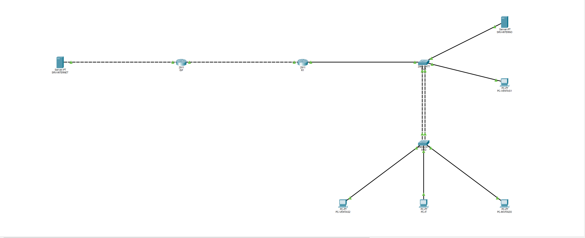

# Laboratorio de red corporativa con Cisco Packet Tracer

Red de una pequeña empresa con segmentación por VLAN, enrutamiento entre VLAN, salida a Internet con NAT, filtrado con ACL y medidas básicas de seguridad en capa 2 y acceso remoto. Hecho en Packet Tracer 9.0.1.



## Qué incluye

| Tecnología | Dónde |
|---|---|
| VLANs 10/20/30/50/99/999 | SW1, SW2 |
| Router-on-a-stick (802.1Q) | R1 Gi0/0.x |
| EtherChannel LACP | SW1 ↔ SW2 (Fa0/23-24, Po1) |
| Rapid-PVST (SW1 root) | SW1, SW2 |
| DHCP | R1 |
| NAT/PAT (overload) | R1 Gi0/1 |
| ACL extendidas | R1 (VENTAS-IN, INVITADOS-IN) |
| Port security (sticky) | puertos de acceso |
| PortFast + BPDU guard | puertos de acceso |
| SSH v2 con ACL de acceso | R1, SW1, SW2 |

## Topología

```
SRV-INTERNET -- ISP -- R1 -- SW1 ==(Po1 LACP)== SW2
                                |  |             |  |  |
                     SRV-INTERNO  PC-VENTAS1     |  |  PC-INVITADO
                                          PC-VENTAS2  PC-IT
```

Cableado completo en [docs/direccionamiento.md](docs/direccionamiento.md).

## Cómo abrirlo

Abre `topologia/laboratorio-red.pkt` con Cisco Packet Tracer 9.0.1.

## Documentación

- [Direccionamiento y VLANs](docs/direccionamiento.md)
- [Plan de pruebas y resultados](docs/plan-pruebas.md)
- [Problemas encontrados y soluciones](docs/troubleshooting.md)
- [Configuraciones](configs/)

## Aviso

Todas las contraseñas y claves de este repositorio son de laboratorio y no se usan en ningún sistema real.

## Licencia

MIT
